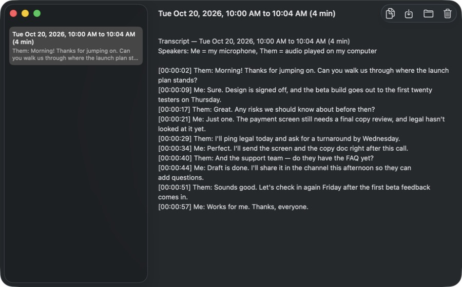
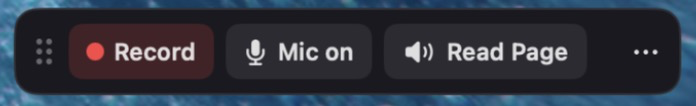
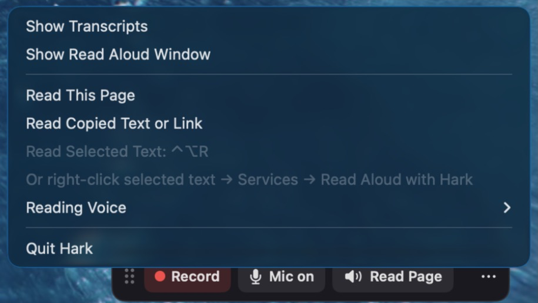
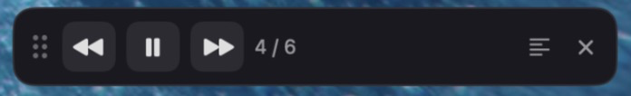

# Hark

**Private meeting notes and read-aloud for macOS. Everything runs on your Mac.**

Hark is a small always-on-top bar. Click **Record** and it captures two things at
once: your microphone ("Me") and everything your Mac plays, such as the other
people on a Zoom, Teams, or Meet call ("Them"). Click **Stop** and a few moments
later you have a timestamped, speaker-labelled transcript. No meeting bot joins
the call, no audio is uploaded, and no account is needed.

It also reads to you. Click **Read Page** on the bar and a calm British narrator
voice reads the article in your browser, while a window highlights each sentence
as you hear it. You can also right-click any selected text → **Services → Read
Aloud with Hark**.



| Idle bar | ⋯ menu | Reading |
|---|---|---|
|  |  |  |

## Features

- **Two-sided transcripts.** "Me" and "Them" are recorded as separate tracks, so
  every line knows who said it. Output is plain text in `~/Documents/Transcripts/`:

  ```text
  [00:00:02] Them: Morning! Can you walk us through where the launch plan stands?
  [00:00:09] Me: Sure. Design is signed off, and the beta build goes out Thursday.
  ```

- **Mute without stopping.** Mic on/off is its own button. A muted mic records
  silence, so the two tracks stay in sync.
- **No speech, no file.** A recording where nobody talked leaves nothing behind.
- **Transcript library.** The main window lists every transcript, newest first,
  with Copy (handy for pasting into an AI chat), Save a Copy, Show in Finder, and
  Move to Trash.
- **Read Aloud.** Reads the web page you're looking at, selected text, or a
  copied link, keeping just the article (no menus, ads, or comments). While it
  reads, the bar becomes a player: ⏮ back · ⏸ pause · ⏭ skip · sentence count ·
  ✕ stop. Several voices to pick from.
- **Follow along.** The Read Aloud window shows the text with the sentence being
  read highlighted, scrolls with it, and jumps to any sentence you click. Space
  pauses; ← and → go back and skip.
- **Three ways to start a reading.** The bar's **Read Page** button (Safari,
  Chrome, Edge, Brave, Arc, Vivaldi), the **Services** menu on any selected text,
  or ⌃⌥R for the current selection.
- **Safe by design.** Read Aloud is turned off while recording, so the reading
  voice never ends up in a transcript.

## How it works

```
 Mic ──────────────► mic.caf ─────┐
                                  ├─► afconvert ─► whisper.cpp + Silero VAD ─► merge by time ─► .txt
 Core Audio tap ───► system.caf ──┘
```

- **Capturing the other side of the call.** macOS 14.4 added *process taps*
  (a way to listen to audio other apps play). Hark makes a tap with
  `CATapDescription`, wraps it in a private aggregate device, and writes its audio
  from a Core Audio IO callback. The mic is recorded with `AVAudioEngine`. No
  virtual audio driver like BlackHole is needed.
- **Transcription.** After Stop, each track is turned into 16 kHz mono WAV and
  sent to [whisper.cpp](https://github.com/ggml-org/whisper.cpp) (large-v3-turbo
  model). Silero VAD (voice activity detection, which skips the silent parts) stops
  Whisper from inventing words during silence. The two tracks' segments are sorted
  by time, and back-to-back lines from the same speaker are joined.
- **Crash-safe.** Each recording lives in its own session folder until its
  transcript is written. If something fails, the audio is kept and can be
  transcribed later from the ⋯ menu or the command line.
- **Read Aloud engine.** A long-running Python helper runs
  [Kokoro](https://github.com/thewh1teagle/kokoro-onnx) (an 82M-parameter
  text-to-speech model on ONNX) and [trafilatura](https://github.com/adbar/trafilatura)
  (article extraction). The app talks to it in JSON lines over stdin/stdout.
  Text is split into sentences, and up to three sentences are made ahead of the
  one playing, so playback starts fast and never waits between sentences.
  Every reading gets a run token, a number that changes on each stop or skip,
  so late replies from the helper are ignored instead of played.
- **Read This Page.** Hark finds the browser window nearest the front (from the
  window list) and asks that browser for its front tab's address with AppleScript.
  macOS asks once per browser (Privacy & Security → Automation). Firefox has no
  AppleScript support, so it gets a clear error instead.
- **Services menu.** "Read Aloud with Hark" is declared under `NSServices` in
  `Info.plist`. macOS hands Hark the selected text directly, so no extra permission
  is needed.
- **Global shortcut.** ⌃⌥R uses Carbon's `RegisterEventHotKey`. It copies the
  current selection with a simulated ⌘C, which needs Accessibility permission.
- **First-run setup.** If a model file or the Read Aloud environment is missing,
  a setup window downloads it from pinned versions, checks each file's SHA-256
  checksum, and builds the Python environment with
  [uv](https://github.com/astral-sh/uv) from a locked, hash-checked package list.
  Everything stays inside `~/Library/Application Support/Hark/`.
- **Fails loudly.** Missing models, denied permissions, and helper errors show a
  clear alert with the fix. Nothing is silently skipped.

Built with Swift 6 tooling and SwiftUI + AppKit, using only the Command Line
Tools (no Xcode project).

## Requirements

- macOS 15 or later on Apple Silicon
- About 2.5 GB of free space for the models and the Read Aloud environment

## Install the ready-made app

Open `Hark-<version>.dmg` and drag Hark to Applications. On first launch Hark
downloads its models (about 2.1 GB, one time) and sets up Read Aloud. Nothing
else to install.

## Build from source

You also need the Xcode Command Line Tools (`xcode-select --install`) and
[Homebrew](https://brew.sh).

1. Install whisper.cpp:

   ```bash
   brew install whisper.cpp
   ```

2. Download two models into `~/Library/Application Support/Hark/models/`:
   - `ggml-large-v3-turbo.bin` from [huggingface.co/ggerganov/whisper.cpp](https://huggingface.co/ggerganov/whisper.cpp)
   - `ggml-silero-v5.1.2.bin` from [huggingface.co/ggml-org/whisper-vad](https://huggingface.co/ggml-org/whisper-vad)

3. Optional, for Read Aloud: install [uv](https://github.com/astral-sh/uv) and run
   the one-time setup. It makes a Python 3.12 environment and downloads about
   350 MB of voice models into `~/Library/Application Support/Hark/reader/`.

   ```bash
   brew install uv
   ./Resources/setup-reader.sh
   ```

4. Build and install:

   ```bash
   ./build.sh
   ```

   This builds a release binary, wraps it in `Hark.app`, signs it ad hoc, and
   installs it to `~/Applications/Hark.app`.

On first use, macOS asks for **Microphone** and **System Audio Recording**
permission. ⌃⌥R also needs **Accessibility** (System Settings → Privacy &
Security). The ⋯ → **Read Copied Text or Link** item works without it.

Because the app is signed ad hoc, macOS treats every rebuild as a new app. Grant
the permissions again after each rebuild.

Steps 2 and 3 are optional: if you skip them, the setup window does them on
first launch (it still needs `brew install uv`).

## Build the release DMG

`release.sh` makes the self-contained, signed, notarized `Hark-<version>.dmg`
that needs no Homebrew. It builds whisper-cli from source as a single file, bundles
a checksum-checked copy of uv, signs everything with the hardened runtime, and
sends the app and the DMG to Apple's notary service.

```bash
brew install cmake
HARK_SIGN_IDENTITY="Developer ID Application: Your Name (TEAMID)" \
HARK_NOTARY_PROFILE="hark-notary" ./release.sh
```

`HARK_NOTARY_PROFILE` is the name you saved with
`xcrun notarytool store-credentials`. `./release.sh --unsigned` makes a test build
that only opens on the Mac that built it. Output goes to `build/release/`.

## Recover a recording by hand

If a transcription fails, its audio stays in a session folder. Transcribe it from
the command line:

```bash
~/Applications/Hark.app/Contents/MacOS/Hark --transcribe ~/Library/Application\ Support/Hark/sessions/<folder>
```

## Project layout

| File | Job |
|---|---|
| `Sources/Hark/AppModel.swift` | Idle → recording → transcribing → saved state flow, mic mute, alerts |
| `Sources/Hark/FloatingBar.swift` | Always-on-top SwiftUI bar in a non-activating panel |
| `Sources/Hark/LibraryView.swift` | Main window: transcript list, viewer, copy/save/trash |
| `Sources/Hark/AppDelegate.swift` | Launch, menu bar, Dock reopen, quit confirmation |
| `Sources/Hark/SetupWindow.swift` | First-run setup: checked downloads + Read Aloud environment |
| `Sources/Hark/MicRecorder.swift` | Mic → `mic.caf` (mute writes silence so timelines stay aligned) |
| `Sources/Hark/SystemAudioRecorder.swift` | Core Audio process tap → `system.caf` |
| `Sources/Hark/TranscriptionPipeline.swift` | afconvert → whisper-cli (+ Silero VAD) → merge → .txt |
| `Sources/Hark/RecordingSession.swift` | One folder per recording in `~/Library/Application Support/Hark/sessions/` |
| `Sources/Hark/AppPaths.swift` | All paths, model names, language, error types |
| `Sources/Hark/ReaderModel.swift` | Read Aloud: sentence list, prefetch, ⏮ ⏸ ⏭ ✕, voice choice |
| `Sources/Hark/ReaderEngine.swift` | Starts and talks to the Python helper (JSON lines) |
| `Sources/Hark/ReaderWindow.swift` | Read Aloud window: highlighted sentence, click to jump |
| `Sources/Hark/BrowserPage.swift` | Read This Page: front browser tab's address via AppleScript |
| `Sources/Hark/ReadAloudService.swift` | "Read Aloud with Hark" in the Services menu |
| `Sources/Hark/HotKey.swift` | ⌃⌥R shortcut; copies the selection |
| `Resources/reader_helper.py` | Kokoro text-to-speech + trafilatura article extraction |
| `Resources/setup-reader.sh` | One-time Read Aloud setup from Terminal |
| `Resources/reader-requirements.txt` | Locked Python packages with checksums |
| `Resources/Hark.entitlements` | Mic + Apple Events permissions for the hardened runtime |
| `build.sh` | Developer build into `~/Applications` |
| `release.sh` | Signed, notarized DMG for distribution |
| `Resources/make-icon.sh` | Rebuilds `Resources/AppIcon.icns` |

## Known limits

- English only for now (`AppPaths.whisperLanguage`).
- With speakers instead of headphones, the mic also hears the other people, so
  some "Them" lines may show up twice, once as "Me".
- Switching audio output mid-recording (for example, AirPods disconnecting) can
  stop the "Them" capture.
- If System Audio Recording permission is denied, macOS gives silence instead of
  an error, so the transcript has no "Them" lines.
- Read Aloud's helper log is at `~/Library/Application Support/Hark/reader/helper.log`.

## Be considerate

Recording laws differ by place. Many require everyone's consent. Tell people
when you are taking notes.

## License

[MIT](LICENSE). Third-party parts and their licenses are listed in
[THIRD_PARTY_NOTICES.md](THIRD_PARTY_NOTICES.md).
